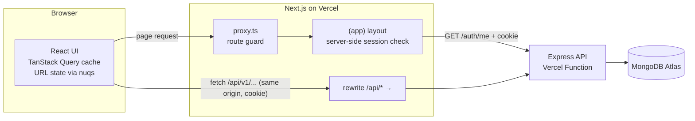
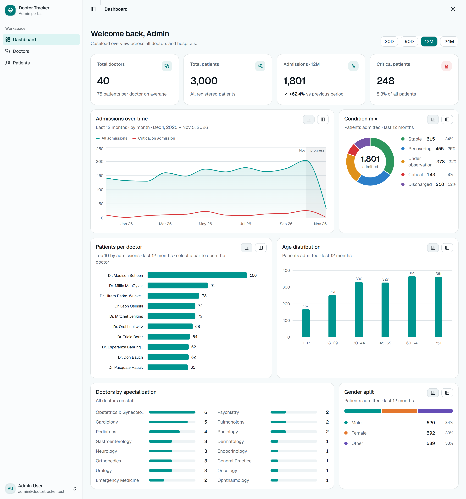
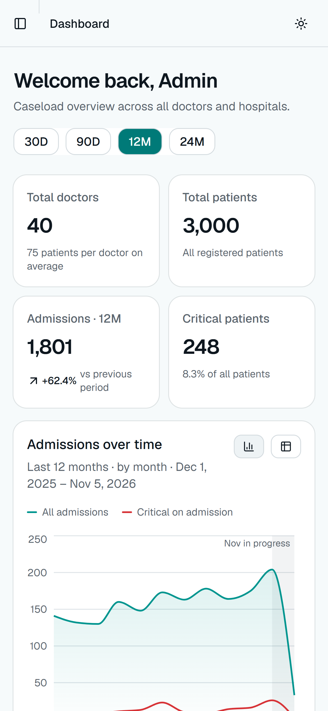
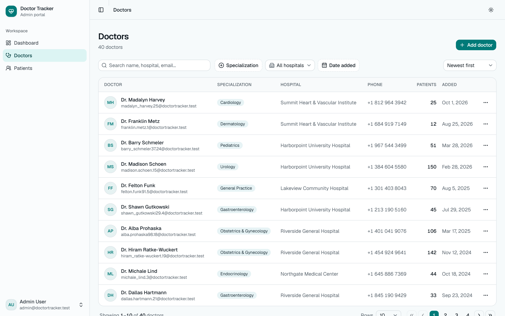
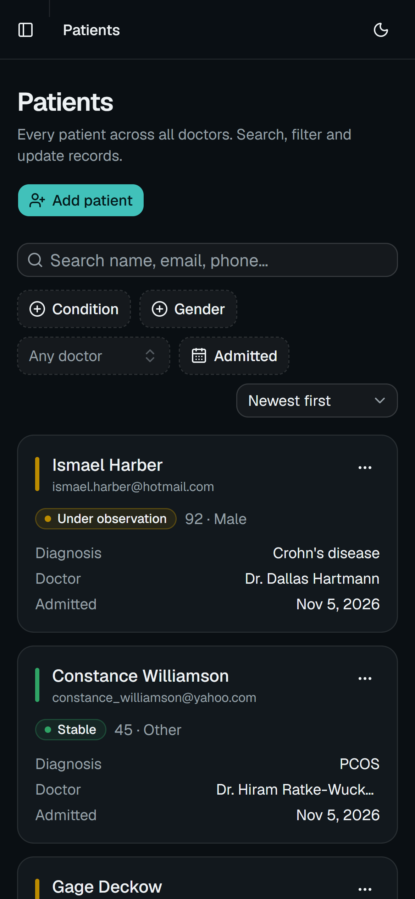
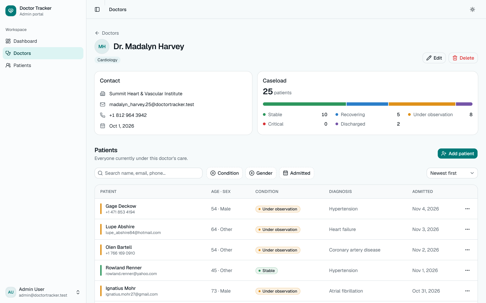
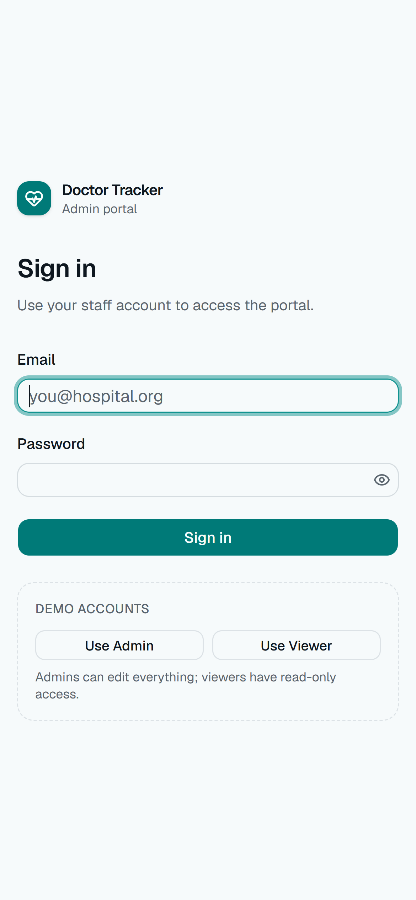
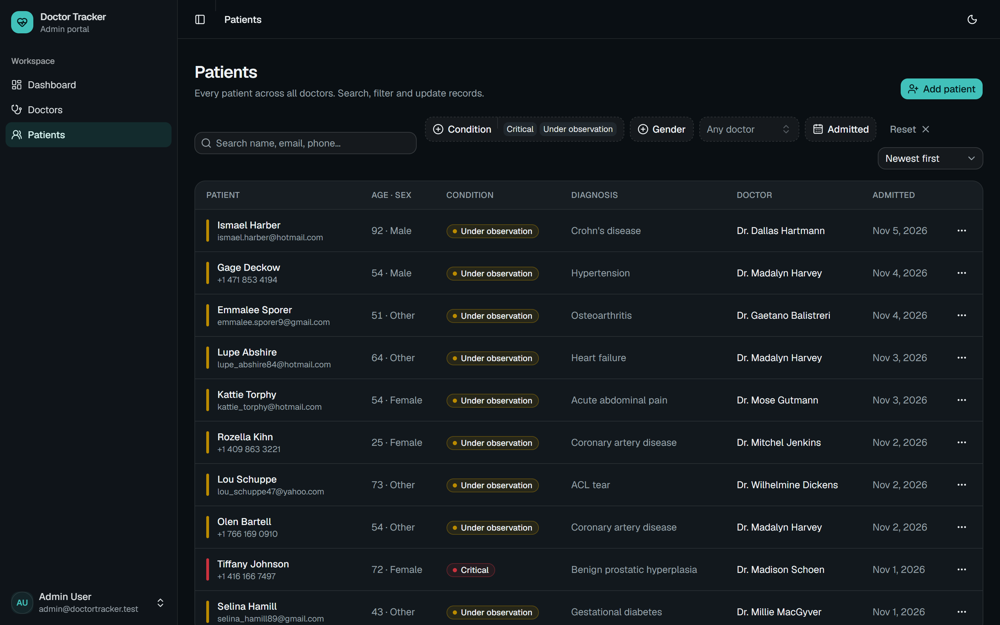
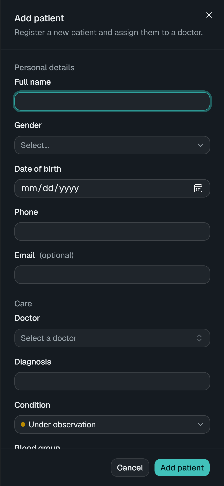

# Doctor Tracker — Web

Doctor Tracker is a secure admin portal where hospital staff manage doctors and the patients under their care, and see at a glance how the caseload is changing. Staff sign in to find any doctor or patient in a few keystrokes, filter by specialization, condition, gender or admission date, and add, edit or remove records. A live dashboard shows totals, admissions trends, the condition mix, patients per doctor and age groups. This repository is the **Next.js frontend**. It talks to a separate Express + MongoDB REST API over HTTP.

|                 |                                                                                                             |
| --------------- | ----------------------------------------------------------------------------------------------------------- |
| **Live app**    | https://doctor-tracker-web-pi.vercel.app                                                                    |
| **Live API**    | https://doctor-tracker-api-five.vercel.app ([`/health`](https://doctor-tracker-api-five.vercel.app/health)) |
| **API repo**    | https://github.com/OishwaryaRoy/doctor-tracker-api                                                          |
| **Demo admin**  | `admin@doctortracker.test` / `Admin@12345` (full access)                                                    |
| **Demo viewer** | `viewer@doctortracker.test` / `Viewer@12345` (read-only)                                                    |

The login page also has one-click **Use Admin / Use Viewer** buttons.

## Features

- **Authentication and authorization:**
  - Route guard in `proxy.ts`, then server-side session verification before any protected UI renders.
  - The session is an `httpOnly` cookie and is never readable by JavaScript.
  - Roles: **admin** can edit; **viewer** is read-only. Controls are hidden in the UI and rejected by the API.
- **Dashboard:**
  - KPI tiles: totals, admissions vs the previous period, critical patients.
  - Admissions trend, condition mix, top 10 patients per doctor, age distribution, specializations, gender split.
  - 30D / 90D / 12M / 24M range, time-zone-correct buckets, and a table view for every chart.
- **Doctors:**
  - Searchable, filterable list (specialization, hospital, date added) with sorting and pagination; create, edit and delete.
  - Doctor page: contact details, caseload breakdown, and that doctor's patients, with add, edit and remove.
- **Patients:**
  - Search by name, email or phone digits; filter by condition, gender, doctor and admission date; sort; paginate.
  - Edit in a side sheet, reassign the doctor, delete (optimistic).
- **UX:**
  - Responsive: tables become cards on phones, and the sidebar becomes a drawer.
  - Dark and light themes, skeletons on first load, and dimmed previous data while refetching (no flashing).
  - Toasts, confirm dialogs, inline validation that mirrors the API, server field errors mapped onto inputs.
  - Empty and error states with retry, keyboard-accessible primitives (Radix), reduced-motion support.

## Tech stack

Next.js 16 (App Router, Turbopack) · React 19 · TypeScript · Tailwind CSS v4 · shadcn/ui (Radix) · TanStack Query v5 · nuqs (URL state) · React Hook Form + Zod 4 · Recharts 3 · date-fns · sonner · next-themes.

## Setup guide

**Prerequisites:** Node.js ≥ 20.9, and the [API](https://github.com/OishwaryaRoy/doctor-tracker-api) running locally. The quickest way is `npm run dev:memory` in the API repo, which needs no database.

```bash
git clone https://github.com/OishwaryaRoy/doctor-tracker-web.git
cd doctor-tracker-web
npm install
cp .env.example .env.local     # API_URL defaults to http://localhost:4000
npm run dev                    # http://localhost:3000
```

Sign in with one of the demo accounts above (the API's seed script creates them).

| Script                    | What it does                                    |
| ------------------------- | ----------------------------------------------- |
| `npm run dev`             | Dev server (Turbopack)                          |
| `npm run build` / `start` | Production build / serve                        |
| `npm run typecheck`       | Generate route types, then `tsc --noEmit`       |
| `npm run lint` / `format` | ESLint / Prettier (with Tailwind class sorting) |

### Environment variables ([`.env.example`](.env.example))

| Variable                | Default                 | Purpose                                                                                                     |
| ----------------------- | ----------------------- | ----------------------------------------------------------------------------------------------------------- |
| `API_URL`               | `http://localhost:4000` | Where `/api/*` is proxied and where the server verifies sessions. Server-only, never shipped to the browser |
| `SESSION_COOKIE_NAME`   | `dt_session`            | Must match the API's `COOKIE_NAME`                                                                          |
| `NEXT_PUBLIC_DEMO_MODE` | `true`                  | Show the demo-account buttons on the login page                                                             |

## System architecture



**What happens on a request**

1. **Navigation.** `proxy.ts` runs first. If there's no session cookie, or its `exp` has passed, it redirects to `/login?next=…` before anything renders. Signed-in users visiting `/login` go to the dashboard.
2. **Session verification.** The `(app)` layout is a Server Component. It calls `GET /auth/me` with the cookie, so the session is checked by the API, not just decoded. A rejected session goes to `/signout`, which clears the cookie and shows the login page. The verified user goes into a `SessionProvider`, which drives role-based UI.
3. **Data.** Client components fetch `/api/v1/...` on their own origin, and Next.js rewrites those calls to the API. TanStack Query caches each response under a structured key (e.g. `["patients","list",{…filters}]`).
4. **Mutations** invalidate exactly the affected key prefixes:
   - A new patient refreshes patient lists, doctor counts and dashboard stats.
   - Deletes are optimistic, with rollback on error.
5. **Expiry.** A 401 from any request (session expired mid-use) sends the user through `/signout?next=…` and back to where they were after signing in.

**Folder structure** — organized by feature. Shared UI is separate from domain code.

```
src/
  app/                     routes only (thin): layouts, pages, loading/error/not-found
    (auth)/login/          public
    (app)/                 protected shell: dashboard, doctors, doctors/[id], patients
    signout/route.ts       clears a rejected session cookie
  proxy.ts                 route guard (Next 16's successor to middleware.ts)
  components/
    ui/                    shadcn/ui primitives
    shared/                DataTable, PaginationBar, SearchInput, FacetedFilter,
                           DateRangeFilter, FilterToolbar, ConfirmDialog, states…
    layout/                AppSidebar, AppHeader, ThemeToggle, Brand
  features/
    auth/                  login form, session context, login/logout mutations
    doctors/               api hooks, list page, detail page, form dialog, picker
    patients/              api hooks, shared PatientList, form sheet, page
    dashboard/             overview query, charts, stat & chart cards
    meta/                  option lists (enums, hospitals) from the API
  hooks/                   useListState (URL-synced table state), useIsMobile
  lib/                     api client & types, query client, formatting, labels, session
```

## Technical decisions

### 1. Same-origin API proxy + httpOnly cookie (instead of a token in `localStorage`)

The frontend and API are separate Vercel projects. `vercel.app` is on the Public Suffix List, so `web.vercel.app` and `api.vercel.app` count as **different sites**. If the browser called the API directly, the session cookie would be third-party, and browsers increasingly block those. The common workaround is to keep a JWT in `localStorage` and send it as a header. That exposes the token to any XSS payload.

**What we do:** `next.config.ts` rewrites `/api/:path*` to the API, so the browser only ever talks to its own origin.

- **The cookie is first-party,** with `httpOnly`, `Secure` and `SameSite=Lax`. JavaScript can't read it, and it isn't sent on cross-site POSTs (CSRF).
- **No CORS preflights in production.** `API_URL` is a server-only variable, so the API's address isn't hard-coded into the client bundle.
- **Pages can be guarded on the server.** `proxy.ts` makes a cheap UX redirect from the cookie's `exp`. The `(app)` layout then does the real verification against the API before rendering. The API still verifies the JWT on every call, so it remains the security boundary.

**Trade-off:** every API call makes one extra hop through Vercel's edge, a few milliseconds. In exchange, no token handling lives in client code.

### 2. TanStack Query for server state + the URL for UI state (instead of Redux or Context)

Almost everything on screen is **server state**: lists, details, aggregates owned by the API. Redux or Context would mean re-implementing caching, deduplication, loading and error flags, refetching and invalidation by hand. A single context holding all filters would also re-render every consumer on each keystroke.

- **TanStack Query** owns server state:
  - It caches per query key, with a 30 s `staleTime`, so moving between pages is instant.
  - It dedupes concurrent requests and cancels in-flight ones (`AbortSignal`) when filters change.
  - With `placeholderData: keepPreviousData`, the current page stays on screen (dimmed) while the next loads, instead of flashing skeletons.
  - Mutations invalidate key prefixes. Patient deletes are optimistic, with rollback on error.
- **The URL** owns table and dashboard state (search, filters, sort, page, range), through `nuqs`:
  - Views are **shareable and bookmarkable**, survive refresh, and work with Back/Forward (paging pushes history, filtering replaces it).
  - Updates are shallow, so they never re-run server components.
- **Local component state** covers only ephemeral UI (open dialogs, form drafts in React Hook Form).

This leaves no global client store at all, and avoids unnecessary re-renders:

- Table columns are memoized and `DataTable` is `memo`'d.
- Search is debounced (300 ms) and keeps its own text state, so typing doesn't re-render the table.
- The doctor picker uses `useDeferredValue`.

## Performance & quality notes

- **Network:**
  - Only the current page of rows is fetched (10–100), with the total counted server-side.
  - The dashboard is a single request, answered by one MongoDB `$facet` pass.
  - Option lists are cached for 10 minutes.
- **Rendering:**
  - Route-level `loading.tsx` and `error.tsx`, plus Suspense boundaries around search-param readers.
  - Charts respect `prefers-reduced-motion`.
- **Charts and accessibility:**
  - All chart colors were checked with a palette validator: color-blind separation, a normal-vision floor, and contrast, in light and dark mode.
  - Condition colors are ordered so red and green are never adjacent.
  - Every chart has a table view, legends sit beside color keys, and identity never relies on color alone.
- **Security headers** (`X-Frame-Options: DENY`, `nosniff`, `Referrer-Policy`, `Permissions-Policy`), `poweredByHeader` off, and open-redirect-safe `?next=` handling.

## Visual evidence

| Desktop                                                             | Mobile                                                     |
| ------------------------------------------------------------------- | ---------------------------------------------------------- |
|                 |  |
|                     |    |
|         |          |
|  |   |
